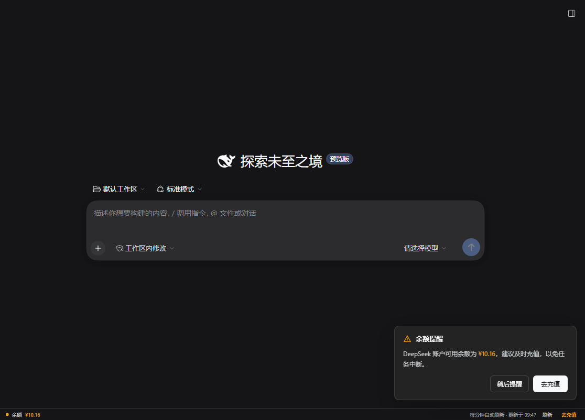

# DSH 余额提醒插件（dsh-balance-reminder）

在 DeepSeek Harness Web 界面底部常驻显示 DeepSeek 平台钱包余额，并在余额偏低时弹出提醒。  
余额通过 DSH 已登录的 DeepSeek 账号读取（`account.getBalance`），**不需要另外配置 API Key**。



## 功能

- **常驻余额条**：界面最底部一行，显示充值余额 + 赠金合计，每分钟自动刷新，也可点「刷新」立即读取。
- **低余额变色**：人民币余额低于 ¥20 变琥珀色，低于 ¥5 变红色。
- **低余额提醒卡**：低于 ¥20 时在右下角弹出提醒，可直接「去充值」或「稍后提醒」；余额恢复后再次低于阈值会重新提醒。
- **断线不伪造余额**：读取失败时明确显示失败原因，不会把失败当成 ¥0.00。
- 中英文文案跟随界面语言。

## 安装

### 方式一：通过插件索引（推荐）

1. 在 DSH 打开 **插件** → **实验性插件** → 打开「自定义插件索引」
2. 点 **发现** → **添加索引源**，填入：

   ```
   https://cdn.jsdelivr.net/gh/AdyVany/dsh-balance-reminder@main/market/index.json
   ```

3. 搜索「余额」或「Balance」→ 安装

### 方式二：直接安装 tarball（访问 GitHub 不稳定时用）

```
dsh plugin add "https://cdn.jsdelivr.net/gh/AdyVany/dsh-balance-reminder@main/dist/dsh-balance-reminder-0.1.0.tgz"
```

### 方式三：本地开发

```
plugin_manager install_bundle target="<本目录绝对路径>"
```

## 数据来源与隐私

- 读取的是当前 DSH 账号登录态下的 DeepSeek 平台钱包摘要（充值钱包 / 赠金钱包的币种与余额字符串）。
- 插件不保存、不打印 access token，也不把余额发送到 DeepSeek 之外的任何地方。
- 只有界面打开时才会每分钟请求一次余额；页面隐藏时暂停自动刷新，切回页面时立即刷新。

## 调整阈值

阈值目前是 `client.js` 中的常量：`WARN_BELOW = 20`、`CRITICAL_BELOW = 5`、`REFRESH_MS = 60 * 1000`。改完后保存文件，页面会通过 HMR 重新加载该插件（首次安装后如未生效，刷新页面即可）。

## 兼容性

- 需要 DSH `>=0.2.0 <0.3.0`
- 依赖 0.2.x 的 Web Client 插槽（`shell.bottom`、`shell.overlay`）和账号远程接口

## 许可

MIT
